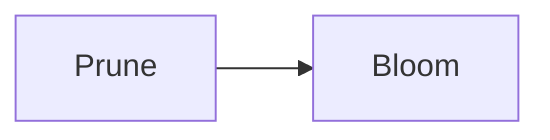

`rosarian`'s description note, which titles its tag page, and so its share card (share-card), and
draws a diagram on it (mermaid). Its alias is the tag's old name, whose page forwards to this tag's
(aliases).

