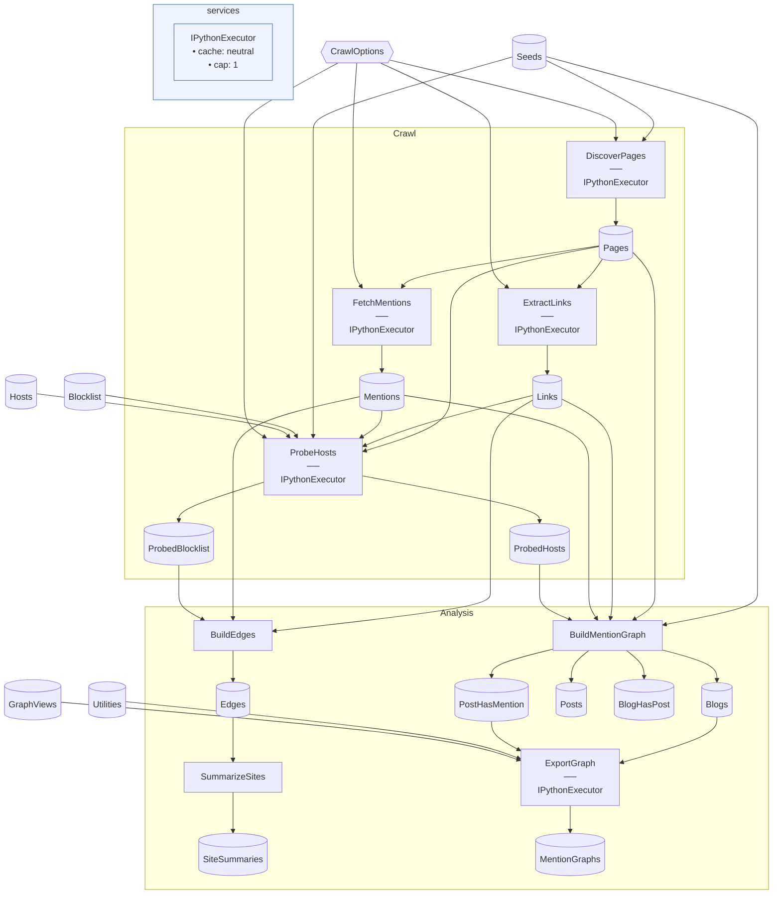

# IndieWeb Graph

> [!NOTE]
> Who on the IndieWeb points at whom?

This project maps who links to whom across a handful of personal sites, by crawling their posts
and the webmentions those posts received.

This project:

- Crawls each seed site in Python: lists its pages from its sitemaps and feeds, reads the links
  out of their content, and asks [webmention.io](https://webmention.io/) for the webmentions they
  received, where the site uses it.
- Probes the sites the seeds point at, and adds those that show no sign of being someone's
  IndieWeb site (no webmention endpoint, no h-card) to the blocklist, for this run and the next.
- Analyzes the crawl in C#: counts the links and mentions between sites by kind, without the
  blocklisted platforms, and summarizes each site's place in the graph.

It's a [Flowthru](https://github.com/chaoticgoodcomputing/flowthru) project, patterned on the
[SpaceflightsPython](https://github.com/chaoticgoodcomputing/flowthru/tree/main/examples/starter/SpaceflightsPython)
starter. [CONTEXT.md](./CONTEXT.md) defines its terms.

## Getting Started

It needs the .NET 10 SDK and [`uv`](https://docs.astral.sh/uv/). From the repo root, set up the
Python environment and the seeds, then crawl and analyze:

```bash
pnpm nx run @chaoticgoodcomputing/indieweb-graph:setup
pnpm nx run @chaoticgoodcomputing/indieweb-graph:crawl
pnpm nx run @chaoticgoodcomputing/indieweb-graph:analyze
```

`setup` copies [`seeds.sample.json`](./Data/_01_Raw/seeds.sample.json) to `Data/_01_Raw/seeds.json`,
your own list of seeds, which isn't committed. The graph lands in `Data/_02_Primary/edges.csv`, and
each site's summary in `Data/_03_Reporting/sites.csv`. The mention graph, of webmention-compatible
blogs only, is four tables in `Data/_02_Primary`: `blogs.csv` and `posts.csv`, its nodes, and
`blog_has_post.csv` and `post_has_mention.csv`, its edges, the latter from the mentioning post to
the mentioned. ExportGraph lays it out, blog to blog, and writes it to
`Data/_03_Reporting/mention-graph.json` and `mention-graph.svg`, which are committed, and each view of
[`graph-views.csv`](./Data/_01_Raw/graph-views.csv), the graph of only some seeds, beside them as
`mention-graph.<view>.json` and `.svg`; `copy-to-blog` copies them all beside the blog's
`IndiewebGraph` widget (`content/public/widgets/indieweb-graph`), which draws a view by its `view`:

```bash
pnpm nx run @chaoticgoodcomputing/indieweb-graph:copy-to-blog
```

## Concepts

- **Python steps that fetch:** the [Crawl flow](./Flows/Crawl/CrawlFlow.cs) runs
  [`@step` functions](./Flows/Crawl/Steps/discover_pages.py) between typed catalog items. None is
  cacheable, since each does I/O; a re-run is cheap through [their own HTTP cache](./Flows/Crawl/Steps/fetching.py)
  instead, which also throttles each host and follows robots.txt.
- **C# steps that count:** the [Analysis flow](./Flows/Analysis/AnalysisFlow.cs) reads the crawl's
  Parquet back into typed records for [BuildEdges](./Flows/Analysis/Steps/BuildEdgesStep.cs),
  [SummarizeSites](./Flows/Analysis/Steps/SummarizeSitesStep.cs) and
  [BuildMentionGraph](./Flows/Analysis/Steps/BuildMentionGraphStep.cs), one step with four outputs,
  whose tests sit beside them (Flowthru.FUnit).
- **Hand-kept data as catalog items:** the [seeds](./Data/Schemas/SeedSchema.cs), the
  hand-kept rows of the blocklist and the [utilities](./Data/_01_Raw/utilities.csv) are inputs in the [catalog](./Data/Catalog.cs) like any
  crawled data, so a change to either reruns what depends on it.
- **A file read and written by one run:** the [blocklist](./Data/_01_Raw/blocklist.csv) is two
  catalog items, `Blocklist` and `ProbedBlocklist`, so [ProbeHosts](./Flows/Crawl/Steps/probe_hosts.py)
  reads it and writes it back with its findings, which BuildEdges and the next run read. The
  hosts it probed, with their webmention endpoints, are kept the same way, in `Hosts` and
  `ProbedHosts`.
- **Python steps in both flows:** [ExportGraph](./Flows/Analysis/Steps/export_graph.py) is the
  Analysis flow's one Python step, between C#'s: it reads the mention graph's tables and returns
  two strings, the JSON and the SVG, to two text catalog items. Its drawing is
  [pure functions](./Flows/Analysis/Steps/drawing.py), tested without Flowthru, as the crawl's
  parsing is.
- **Options bound from configuration:** how politely to crawl is
  [`CrawlOptions`](./Data/Schemas/CrawlOptions.cs), from [`appsettings.json`](./appsettings.json).

## Structure

### Diagram

<!-- flowthru:mermaid:start -->

<!-- flowthru:mermaid:end -->

### Files

<!-- flowthru:filetree:start -->
```
indieweb-graph/
├── .gitignore
├── .python-version
├── appsettings.json
├── CONTEXT.md
├── Directory.Packages.props
├── IndiewebGraph.csproj
├── Program.cs
├── project.json
├── pyproject.toml
├── README.md
├── uv.lock
├── Data/
│   ├── Catalog.cs
│   ├── _01_Raw/
│   │   ├── blocklist.csv
│   │   ├── graph-views.csv
│   │   ├── seeds.sample.json
│   │   └── utilities.csv
│   ├── _03_Reporting/
│   │   ├── mention-graph.chaotic-good-and-maggie.json
│   │   ├── mention-graph.chaotic-good-and-maggie.svg
│   │   ├── mention-graph.chaotic-good.json
│   │   ├── mention-graph.chaotic-good.svg
│   │   ├── mention-graph.json
│   │   └── mention-graph.svg
│   └── Schemas/
│       ├── BlockedHostSchema.cs
│       ├── BlogHasPostSchema.cs
│       ├── BlogSchema.cs
│       ├── CrawlOptions.cs
│       ├── EdgeSchema.cs
│       ├── GraphViewSchema.cs
│       ├── HostSchema.cs
│       ├── LinkSchema.cs
│       ├── MentionSchema.cs
│       ├── PageSchema.cs
│       ├── PostHasMentionSchema.cs
│       ├── PostSchema.cs
│       ├── SeedSchema.cs
│       ├── SiteSummarySchema.cs
│       └── UtilitySchema.cs
├── Flows/
│   ├── Analysis/
│   │   ├── AnalysisFlow.cs
│   │   └── Steps/
│   │       ├── __init__.py
│   │       ├── BuildEdgesStep.cs
│   │       ├── BuildMentionGraphStep.cs
│   │       ├── drawing.py
│   │       ├── export_graph.py
│   │       └── SummarizeSitesStep.cs
│   └── Crawl/
│       ├── CrawlFlow.cs
│       └── Steps/
│           ├── __init__.py
│           ├── discover_pages.py
│           ├── extract_links.py
│           ├── fetch_mentions.py
│           ├── fetching.py
│           ├── parsing.py
│           └── probe_hosts.py
├── scripts/
│   └── sync-readme.mjs
└── tests/
    └── python/
        ├── test_drawing.py
        └── test_parsing.py
```
<!-- flowthru:filetree:end -->
